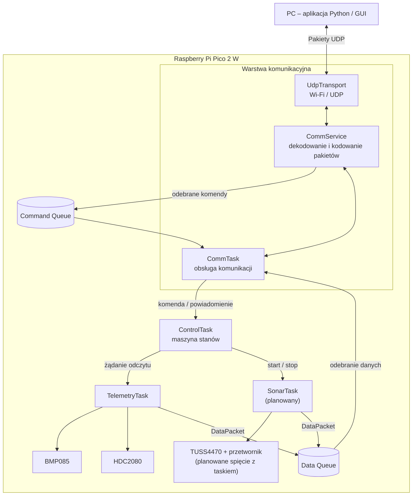
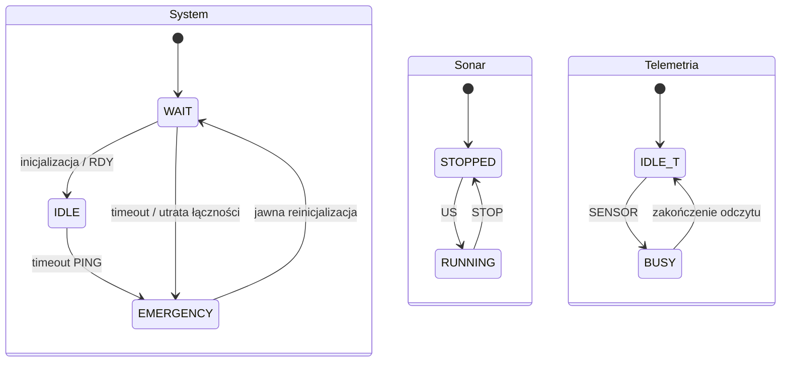
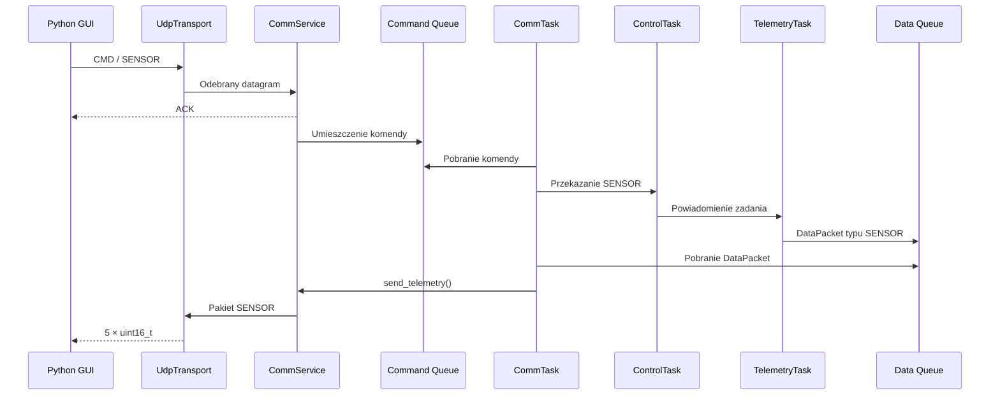

# Dokumentacja architektury i protokołu komunikacyjnego

## Mobilna echosonda ultradźwiękowa -- Raspberry Pi Pico 2 W

> **Status dokumentu:** roboczy, aktualizacja 2026-11-02. Dokument rozdziela
> decyzje przyjęte, propozycje do sprawdzenia oraz kwestie nierozstrzygnięte.
> Nowe ustalenia dotyczą niezależnej pracy sonaru i telemetrii, nadzoru
> połączenia oraz przyszłego podziału i kompresji danych sonaru.

## 1. Cel i zakres

System składa się z mikrokontrolera Raspberry Pi Pico 2 W, modułu
pomiarowego oraz aplikacji komputerowej. Mikrokontroler komunikuje się z
aplikacją przez Wi-Fi i UDP. Aplikacja wysyła komendy sterujące, a
urządzenie odsyła dane telemetryczne, próbki sygnału echa oraz -- w
przyszłości -- dane GPS.

Dokument opisuje:

-   podział oprogramowania na moduły i zadania FreeRTOS,
-   przepływ komend od aplikacji do zadań pomiarowych,
-   przepływ danych pomiarowych z urządzenia do aplikacji,
-   format nagłówka i typy pakietów,
-   aktualnie znane formaty payloadów,
-   elementy wymagające dalszego ustalenia.

## 2. Architektura systemu

### 2.1. Schemat blokowy



**Uwaga do schematu:** `CommTask` jest konsumentem kolejki danych i
wywołuje funkcje `CommService` odpowiedzialne za wysyłanie pakietów. Na
diagramie połączenie `Data Queue` z warstwą komunikacyjną należy
rozumieć jako: `Data Queue → CommTask → CommService → UdpTransport`. W
kodzie odbiór danych z kolejki powinien odbywać się w `CommTask`, a nie
w `ControlTask`.

### 2.2. Odpowiedzialność modułów

  -----------------------------------------------------------------------
  Moduł / zadanie                     Odpowiedzialność
  ----------------------------------- -----------------------------------
  `UdpTransport`                      Obsługa transportu UDP i interfejsu
                                      Wi-Fi.

  `CommService`                       Parsowanie odebranych pakietów,
                                      walidacja, obsługa komend,
                                      generowanie ACK oraz przygotowanie
                                      pakietów wychodzących.

  `CommTask`                          Główna pętla komunikacyjna: odbiór
                                      danych, przekazywanie komend dalej
                                      oraz wysyłanie danych pobranych z
                                      `Data Queue`.

  `Command Queue`                     Kolejka komend odebranych z
                                      aplikacji i oczekujących na
                                      obsłużenie.

  `ControlTask`                       Maszyna stanów urządzenia i
                                      rozdzielanie komend do odpowiednich
                                      zadań.

  `TelemetryTask`                     Odczyt czujników środowiskowych i
                                      przygotowanie pakietu
                                      telemetrycznego.

  `SonarTask`                         Docelowo obsługa pomiaru
                                      ultradźwiękowego oraz zatrzymywania
                                      pomiaru.

  `Data Queue`                        Kolejka danych pomiarowych
                                      oczekujących na wysłanie do
                                      aplikacji.
  -----------------------------------------------------------------------

### 2.3. Przepływ komend i danych

**Komendy -- kierunek PC → Pico 2 W:**

1.  Aplikacja wysyła pakiet UDP.
2.  `UdpTransport` odbiera datagram.
3.  `CommService` sprawdza i dekoduje pakiet.
4.  `CommService` wysyła potwierdzenie ACK i umieszcza poprawną komendę
    w kolejce komend.
5.  `CommTask` pobiera komendę i przekazuje ją do `ControlTask`.
6.  `ControlTask` sprawdza stan urządzenia i zleca wykonanie
    odpowiedniej operacji.

**Dane pomiarowe -- kierunek Pico 2 W → PC:**

1.  Zadanie pomiarowe pobiera dane z czujników lub wykonuje pomiar
    sonarem.
2.  Zadanie tworzy strukturę `DataPacket`.
3.  `DataPacket` trafia do `Data Queue`.
4.  `CommTask` pobiera pakiet z kolejki.
5.  `CommTask` wywołuje odpowiednią funkcję `CommService`, np.
    `send_telemetry()` lub `send_sonar()`.
6.  `CommService` buduje pakiet protokołu, a `UdpTransport` wysyła go do
    aplikacji.

## 3. Model stanów i niezależność pomiarów

Sonar i telemetria mają działać niezależnie. Nie należy modelować ich
jednym stanem `RUNNING`, ponieważ sonar może pracować w trakcie odczytu
telemetrii. Czytelniejszy model składa się z nadrzędnego stanu systemu
oraz dwóch niezależnych stanów funkcjonalnych.

| Obszar | Stany | Znaczenie |
|---|---|---|
| System / łączność | `WAIT`, `IDLE`, `EMERGENCY` | Gotowość do pracy, normalna praca lub stan awaryjny |
| Sonar | `STOPPED`, `RUNNING` | Niezależne uruchamianie i zatrzymywanie pomiaru |
| Telemetria | `IDLE`, `BUSY` | Odczyt czujników na żądanie; drugie żądanie podczas odczytu jest odrzucane lub ignorowane, a nie kolejkowane |



Zasady działania ustalone na tym etapie:

- `US` uruchamia sonar, który pracuje ciągle aż do `STOP`.
- Powtórne `US`, gdy sonar już działa, nie restartuje pomiaru.
- `STOP` zatrzymuje wyłącznie sonar; nie rozłącza aplikacji i nie
  zatrzymuje telemetrii.
- `SENSOR` zleca pojedynczy odczyt telemetrii. Żądanie podczas trwającego
  odczytu nie jest kolejkowane.
- Telemetria jest początkowo wyzwalana na żądanie z GUI. Tryb cykliczny
  lub hybrydowy może zostać dodany później.
- Utrata heartbeat powoduje przejście systemu do `EMERGENCY` i zatrzymanie
  pomiarów. Odzyskanie Wi-Fi samo w sobie nie opuszcza tego stanu.
- Wyjście z `EMERGENCY` wymaga jawnej reinicjalizacji z PC. Po niej
  urządzenie wraca do gotowości, a pomiary pozostają zatrzymane.
- W przyszłości stan awaryjny może uruchamiać procedurę powrotu platformy
  do punktu startowego; nie jest to część obecnego zakresu implementacji.

**Do rozstrzygnięcia:** czy reinicjalizacja będzie realizowana przez
rozszerzenie semantyki `RDY`, czy przez osobną komendę, np. `REINIT`.

## 4. Protokół komunikacyjny

Dotychczasowy protokół wymaga aktualizacji. Poniższy nagłówek 6-bajtowy
jest opisem aktualnego formatu bazowego, a nie zamkniętą specyfikacją
nowej wersji. Nie należy zwiększać go o wiele pól bez wykazania, że są
niezbędne — szczególnie z myślą o przyszłym łączu ExpressLRS.

### 4.1. Ogólny format pakietu

Każdy pakiet składa się z 6-bajtowego nagłówka i opcjonalnego payloadu.

``` text
 0          1          2                 4                 6
 +----------+----------+-----------------+-----------------+
 | PktType  | CmdId    | seq             | len             |
 | 1 bajt   | 1 bajt   | 2 bajty         | 2 bajty         |
 +----------+----------+-----------------+-----------------+
 |                         PAYLOAD                         |
 |                    len bajtów danych                    |
 +---------------------------------------------------------+
```

  ------------------------------------------------------------------------
  Pole                                       Rozmiar Opis
  --------------------- ---------------------------- ---------------------
  `PktType`                                      1 B Rodzaj pakietu, np.
                                                     `CMD`, `ACK`,
                                                     `SENSOR`, `SONAR`,
                                                     `GPS`.

  `CmdId`                                        1 B Identyfikator
                                                     komendy; ma znaczenie
                                                     przede wszystkim dla
                                                     pakietów `CMD` i
                                                     powiązanych z nimi
                                                     `ACK`.

  `seq`                                          2 B Numer sekwencyjny
                                                     pakietu.

  `len`                                          2 B Długość payloadu w
                                                     bajtach.

  `PAYLOAD`                                  `len` B Dane właściwe dla
                                                     danego rodzaju
                                                     pakietu.
  ------------------------------------------------------------------------

**Ważne:** kolejność bajtów (endianness) pól wielobajtowych musi być
jednakowa po stronie Pico i aplikacji Python. Należy ją potwierdzić w
implementacji serializacji i deserializacji. Sam zapis pól w strukturze
C++ nie gwarantuje przenośnego formatu transmisji.

### 4.2. Kierunek rozwoju protokołu

Nowy podział logiczny wiadomości:

| Grupa | Wiadomości | Cel |
|---|---|---|
| Sterowanie | `RDY`, `US`, `STOP`, `SENSOR` | Sterowanie urządzeniem i pomiarami |
| Nadzór łącza | `PING`, `PONG` | Wykrywanie utraty komunikacji |
| Potwierdzenia | `ACK`, `NACK` | Informacja o przyjęciu lub odrzuceniu komendy |
| Dane | `SONAR`, `SENSOR`, `GPS` | Przesyłanie wyników pomiarów |

`PING` jest okresowo wysyłany przez PC. Pico powinno odpowiedzieć
`PONG`. Brak `PING` przez ustalony czas wyzwala `EMERGENCY`. Dokładny
interwał heartbeat i timeout pozostają do ustalenia.

Znaczenie potwierdzeń:

- `ACK` potwierdza przyjęcie / zaakceptowanie komendy, a nie zakończenie
  pomiaru ani dostarczenie danych.
- `NACK` informuje o odrzuceniu komendy, np. z powodu niedozwolonego
  stanu urządzenia lub zajętego zadania telemetrii.
- `PING`/`PONG` służy nadzorowi łącza i nie musi być obsługiwany jak
  zwykła komenda użytkownika.
- Nie planuje się potwierdzania każdej ramki sonaru — generowałoby to
  dodatkowy ruch. Ewentualne potwierdzanie lub retransmisja fragmentów
  wymaga osobnej decyzji.

**Do ustalenia:** dokładny format `ACK` i `NACK`, kod przyczyny w
`NACK`, sposób powiązania odpowiedzi z komendą oraz to, czy `PING` i
`PONG` będą osobnymi typami pakietów, czy komendami. Powyższe nazwy
opisują planowaną semantykę, nie aktualne wartości enumów.

### 4.3. Wartości `PktType`

  Nazwa        Wartość Kierunek / znaczenie
  ---------- --------- ------------------------------------------------
  `CMD`              1 Komenda wysyłana z PC do Pico.
  `ACK`              2 Potwierdzenie związane z odebraną komendą.
  `SENSOR`           3 Dane telemetryczne wysyłane z Pico do PC.
  `SONAR`            4 Próbki pomiarowe sonaru wysyłane z Pico do PC.
  `GPS`              5 Dane GPS wysyłane z Pico do PC.

### 4.4. Wartości `CmdId`

  Nazwa        Wartość Znaczenie
  ---------- --------- ---------------------------------------------------------
  `NONE`             0 Brak przypisanej komendy.
  `RDY`              1 Zgłoszenie gotowości / rozpoczęcie obsługi komunikacji.
  `SENSOR`           2 Żądanie odczytu czujników.
  `US`               3 Żądanie pomiaru ultradźwiękowego.
  `STOP`             4 Zatrzymanie pomiaru.

## 5. Rodzaje przesyłanych pakietów

### 5.1. Pakiety komend -- `CMD`

Komendy są wysyłane z aplikacji PC do mikrokontrolera. Aktualnie
przyjęte komendy nie wymagają payloadu.

  Komenda                 `PktType`          `CmdId` Payload
  ----------------------- ----------- -------------- ---------
  Gotowość                `CMD`            `RDY = 1` pusty
  Odczyt czujników        `CMD`         `SENSOR = 2` pusty
  Pomiar ultradźwiękowy   `CMD`             `US = 3` pusty
  Zatrzymanie pomiaru     `CMD`           `STOP = 4` pusty

Długość payloadu dla powyższych komend wynosi `0 B`, a cały pakiet ma 6
bajtów.

### 5.2. Potwierdzenie -- `ACK`

`ACK` informuje aplikację o przyjęciu / odebraniu komendy. Nie oznacza
automatycznie, że pomiar został zakończony ani że dane pomiarowe zostały
już wysłane.

  -----------------------------------------------------------------------
  Pole                                Stan
  ----------------------------------- -----------------------------------
  `PktType`                           `ACK = 2`

  `CmdId`                             Powinien wskazywać komendę, której
                                      dotyczy potwierdzenie.

  `seq`                               Sposób powiązania z komendą wymaga
                                      potwierdzenia w implementacji.

  `len`                               Do potwierdzenia w implementacji.

  Payload                             Format nie został jeszcze
                                      jednoznacznie ustalony.
  -----------------------------------------------------------------------

### 5.3. Dane telemetryczne -- `SENSOR`

Pakiet `SENSOR` przesyła pięć wartości typu `uint16_t`.

  Parametr                         Wartość
  --------------------------- ------------
  Liczba próbek / pól                    5
  Typ pojedynczego pola         `uint16_t`
  Rozmiar pojedynczego pola            2 B
  Rozmiar payloadu                    10 B
  Rozmiar całego pakietu              16 B

Aktualne wartości testowe używane w `TelemetryTask`:

          Indeks   Wartość
  -------------- ---------
    `samples[0]`      2350
    `samples[1]`      5600
    `samples[2]`     10130
    `samples[3]`      2450
    `samples[4]`      1800

**Do ustalenia:** przypisanie indeksów do konkretnych wielkości
fizycznych, jednostki, sposób skalowania oraz ewentualna obsługa
wartości błędnych. Nie należy zakładać, że powyższe liczby oznaczają już
temperaturę, wilgotność lub ciśnienie -- są to obecnie wartości testowe.

### 5.4. Próbki sonaru -- `SONAR`

Wewnątrz urządzenia próbki powinny pozostać surowymi wartościami ADC
(`uint16_t`). Reprezentację pomiarową należy oddzielić od transmisyjnej,
aby można było dobrać inny format do Wi-Fi i inny do przyszłego łącza
ExpressLRS, bez utraty danych na etapie akwizycji.

Dotychczasowy wariant zakładał wysłanie 1000 próbek `uint16_t` w jednym
pakiecie (2000 B payloadu). Nie jest to docelowa specyfikacja
transmisji. Nawet po kompresji do około 1 kB pakiet może wymagać
podziału na mniejsze fragmenty, zależnie od MTU, transportu i
ograniczeń łącza radiowego.

**Kierunek do zbadania — bezstratna kompresja deltowa:**

- pierwsza próbka (lub punkt ponownej synchronizacji) jest zapisywana
  jako wartość bezwzględna;
- kolejne próbki są kodowane jako różnice względem poprzedniej próbki;
- małe delty mogą zajmować jeden bajt;
- większe delty muszą być kodowane rozszerzonym zapisem albo jako
  specjalny znacznik i pełna wartość bezwzględna;
- kompresja powinna być bezstratna, aby zachować możliwość późniejszej
  analizy surowego sygnału.

To propozycja, a nie zatwierdzony format. Skuteczność należy zmierzyć
na rzeczywistych przebiegach: średni i maksymalny rozmiar, udział delt
mieszczących się w jednym bajcie oraz koszt obliczeniowy.

**Fragmentacja:** ramka sonaru może być dzielona na kilka pakietów.
Odbiornik musi móc rozpoznać fragmenty należące do tej samej ramki,
ustalić ich kolejność i wykryć brakujące fragmenty. Każdy fragment
powinien umożliwiać bezpieczne rozpoczęcie dekodowania, np. przez
umieszczenie wartości bezwzględnej na początku fragmentu. Nie ustalono
jeszcze konkretnego formatu metadanych fragmentu ani maksymalnego
rozmiaru payloadu.

Nie należy na tym etapie dodawać dużego zestawu pól do wspólnego
nagłówka. Najpierw trzeba określić minimalne informacje wymagane do
identyfikacji ramki i fragmentu. Pole `seq` może zostać wykorzystane,
ale jego semantyka musi być jednoznacznie zdefiniowana.

Parametry pomiaru: 1000 próbek, próbkowanie 50 kHz, ADC 12-bitowy,
wartości przechowywane w `uint16_t`.

Przy próbkowaniu 50 kHz odstęp między próbkami wynosi 20 µs. Dla
prędkości dźwięku w wodzie 1480 m/s przyrost odległości odpowiadający
jednej próbce (z uwzględnieniem drogi w obie strony) wynosi 1,48 cm.
Jest to odstęp odległości przypisany kolejnym próbkom, a nie gwarancja
rzeczywistej dokładności całego pomiaru.

### 5.5. Dane GPS -- `GPS`

Typ pakietu `GPS` jest zarezerwowany w protokole (`PktType = 5`), ale
format payloadu nie został jeszcze ustalony.

Do zdefiniowania pozostają m.in.:

-   reprezentacja szerokości i długości geograficznej,
-   jednostki i skala,
-   wysokość, prędkość lub czas pomiaru -- jeśli będą przesyłane,
-   sposób oznaczania braku fixa lub niepoprawnych danych.

## 6. Zestawienie pakietów — stan przejściowy

  --------------------------------------------------------------------------
  Kierunek      Typ           `CmdId`        Payload        Rozmiar payloadu
  ------------- ------------- -------------- ------------- -----------------
  PC → Pico     `CMD`         `RDY`          brak                        0 B

  PC → Pico     `CMD`         `SENSOR`       brak                        0 B

  PC → Pico     `CMD`         `US`           brak                        0 B

  PC → Pico     `CMD`         `STOP`         brak                        0 B

  PC → Pico     `PING`        —              do ustalenia          do ustalenia

  Pico → PC     `PONG`        —              do ustalenia          do ustalenia

  Pico → PC     `NACK`        komenda        kod przyczyny         do ustalenia
                              odrzucona

  Pico → PC     `ACK`         komenda        format do          do ustalenia
                              potwierdzana   ustalenia     

  Pico → PC     `SENSOR`      nie dotyczy    5 ×                        10 B
                                             `uint16_t`    

  Pico → PC     `SONAR`       nie dotyczy    dane próbek /        do ustalenia
                                             kompresja deltowa i
                                             fragmentacja    

  Pico → PC     `GPS`         nie dotyczy    format do          do ustalenia
                                             ustalenia     
  --------------------------------------------------------------------------

## 7. Przykładowy przepływ żądania `SENSOR`



Diagram pokazuje docelowy przepływ. W szczególności przekazanie komendy
do `TelemetryTask` oraz wysłanie danych przez `Data Queue` musi być
sprawdzone w działającej integracji.

## 8. Parametry komunikacji sieciowej

  Parametr        Wartość
  --------------- ----------------------
  Interfejs       Wi-Fi 2,4 GHz
  Tryb Pico       Punkt dostępowy (AP)
  SSID            `PICO_NET`
  Adres IP Pico   `192.168.4.1`
  Adres IP PC     `192.168.4.2`
  Port UDP        `5005`

Dane dostępowe do sieci nie są częścią formatu pakietu. W szczególności
hasła nie należy umieszczać w dokumentacji przeznaczonej do publicznego
udostępnienia.

## 9. Bufory, fragmentacja i ograniczenia rozmiaru

Dotychczasowy surowy payload sonaru miał 2000 B (1000 × `uint16_t`).
Nie oznacza to, że docelowo należy wysyłać taki payload jako jeden
datagram UDP. Duże datagramy mogą podlegać fragmentacji IP, a dla
przyszłego ExpressLRS będą potrzebne znacznie mniejsze jednostki
transmisji. Preferowane jest jawne dzielenie danych na fragmenty na
poziomie aplikacyjnym, z możliwością wykrycia brakujących fragmentów.

Nie ustalono jeszcze docelowego `MAX_PAYLOAD_SIZE`. Wartość ta powinna
wynikać z ograniczeń konkretnego transportu, a nie z rozmiaru całej
ramki sonaru. Warstwa akwizycji nie powinna być ograniczona rozmiarem
pojedynczego pakietu.

Przykładowe stałe opisujące surową ramkę (nie pojedynczy datagram):

```cpp
constexpr uint16_t MAX_DATA_SAMPLES = 1000;
constexpr uint16_t RAW_SONAR_SIZE =
    MAX_DATA_SAMPLES * sizeof(uint16_t);
constexpr uint16_t HEADER_SIZE = 6;
```

Bufory transportowe powinny uwzględniać rozmiar pojedynczego fragmentu,
a nie automatycznie rezerwować miejsce na całą ramkę. Trzeba sprawdzić
limity w `CommService`, `UdpTransport` i parserze Python.

### 9.1. Kolejka danych

Przy przepełnieniu kolejki sonaru rozważany jest wariant usuwania
najstarszej oczekującej ramki, aby zachować możliwie świeże dane. Jest
to decyzja tymczasowa — należy ją zweryfikować pomiarami przepustowości
i zachowaniem GUI. Dane telemetryczne mogą wymagać osobnej polityki,
aby nie były bez potrzeby gubione razem z ramkami sonaru.

## 10. Lista rzeczy do dokończenia / weryfikacji

- [ ] Rozdzielić w implementacji stan systemu, stan sonaru i stan telemetrii.
- [ ] Ustalić semantykę `RDY` podczas pierwszego połączenia i jawnej
      reinicjalizacji po `EMERGENCY`.
- [ ] Dodać `PING`/`PONG` i ustalić interwał oraz timeout heartbeat.
- [ ] Ustalić format `ACK`/`NACK`, kody odrzucenia i powiązanie przez `seq`.
- [ ] Zdefiniować, co dokładnie numeruje `seq`.
- [ ] Ustalić minimalne metadane fragmentu sonaru bez nadmiernego
      rozbudowywania wspólnego nagłówka.
- [ ] Zmierzyć bezstratną kompresję deltową na rzeczywistych danych ADC.
- [ ] Porównać wariant deltowy z surowym `uint16_t` oraz ewentualnym
      kodowaniem zmiennej długości.
- [ ] Ustalić maksymalny rozmiar payloadu dla Wi-Fi/UDP i osobno dla
      przyszłego ExpressLRS.
- [ ] Zachować surowe próbki `uint16_t` wewnątrz urządzenia; konwersję
      wykonywać w warstwie przygotowania transmisji.
- [ ] Zdecydować, jak odbiornik wykrywa niekompletną ramkę i co robi z
      brakującymi fragmentami.
- [ ] Dodać `TelemetryTask` do inicjalizacji systemu i obsłużyć odrzucanie
      kolejnego żądania `SENSOR`, gdy odczyt już trwa.
- [ ] Potwierdzić mapowanie pól pakietu `SENSOR` na wielkości fizyczne
      i jednostki.
- [ ] Ustalić kolejność bajtów pól wielobajtowych (endianness).
- [ ] Zaimplementować i przetestować `SonarTask`.
- [ ] Ustalić format payloadu `GPS`, jeśli transmisja GPS będzie
      realizowana.
- [ ] Zmierzyć obciążenie kolejki danych i zweryfikować tymczasową
      politykę usuwania najstarszej ramki sonaru.

## 11. Decyzje i propozycje — status

| Temat | Status |
|---|---|
| Sonar i telemetria działają niezależnie | Przyjęte |
| Telemetria początkowo na żądanie z GUI | Przyjęte |
| Kolejne żądanie `SENSOR` podczas odczytu nie jest kolejkowane | Przyjęte |
| Sonar działa ciągle od `US` do `STOP` | Przyjęte |
| Ponowne `US` podczas pracy nie restartuje sonaru | Przyjęte |
| `STOP` zatrzymuje wyłącznie sonar | Przyjęte |
| Heartbeat PC → Pico i awaryjne zatrzymanie po timeout | Przyjęte koncepcyjnie; parametry do ustalenia |
| Po odzyskaniu Wi-Fi wymagane jawne wznowienie/reinicjalizacja | Przyjęte koncepcyjnie; komenda do ustalenia |
| Usuwanie najstarszej ramki sonaru przy przepełnieniu kolejki | Propozycja tymczasowa do pomiarów |
| Surowe próbki `uint16_t` wewnątrz Pico | Rekomendacja architektoniczna |
| Bezstratna kompresja deltowa | Kierunek do zbadania, niezatwierdzony |
| Fragmentacja ramek sonaru na poziomie aplikacyjnym | Kierunek do przyjęcia przy projektowaniu formatu |
| Docelowy rozmiar nagłówka i payloadu | Nierozstrzygnięte |

## 12. Zasada aktualizacji dokumentu

Po każdej zmianie protokołu należy zaktualizować jednocześnie:

1.  definicje w `protocol.h`,
2.  kod serializacji i deserializacji po stronie Pico,
3.  parser pakietów po stronie aplikacji Python,
4.  odpowiednią tabelę i diagram w tym dokumencie.

Dokument powinien opisywać rzeczywisty stan kodu. Elementy oznaczone
jako „do ustalenia" lub „planowane" nie powinny być traktowane jako już
działające funkcje.
